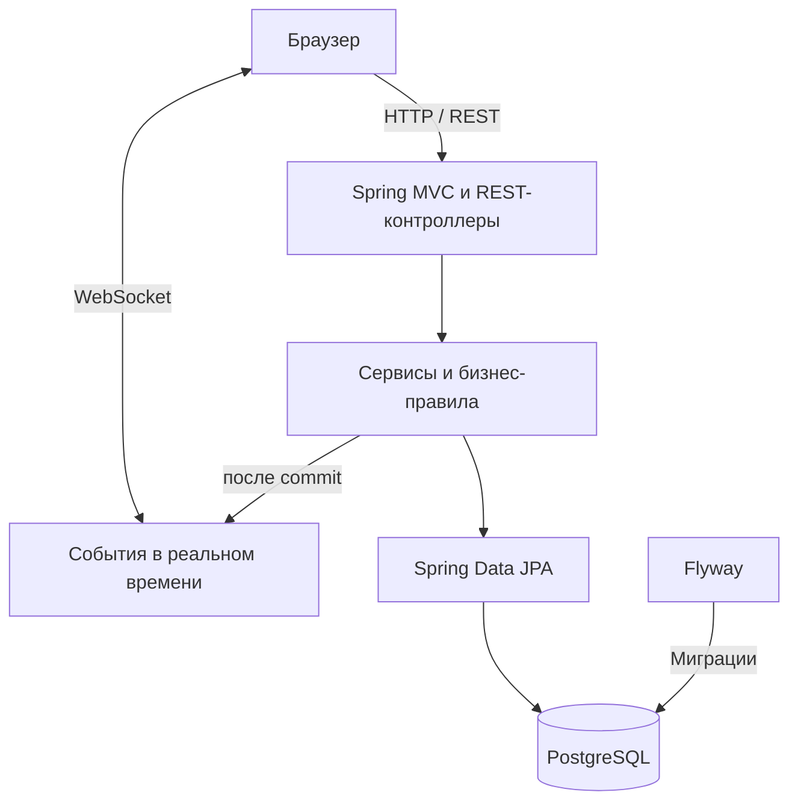

# Orbis

**Orbis** — веб-платформа для управления структурированными данными о людях и связанных с ними локациях. Система объединяет удобный каталог записей, инструменты обработки данных, историю изменений и совместную работу пользователей в реальном времени.

Пользователи могут вести общий реестр, находить нужные объекты по заданным характеристикам, управлять связями между ними и отслеживать выполненные операции — в едином интерфейсе без установки клиентского ПО.

## Возможности

### Каталог людей

- Создание, просмотр, редактирование и удаление записей.
- Хранение имени, координат, роста, веса, цвета глаз и волос, национальности и даты создания.
- Табличный просмотр с серверной пагинацией и сортировкой.
- Фильтрация по имени, цвету глаз и волос, национальности и названию локации. Строковые фильтры используют **точное совпадение**.
- Подробная карточка человека с переходом к связанной локации.

### Управление локациями

- Отдельный каталог локаций с координатами и названиями.
- Просмотр карточки локации и списка связанных людей.
- Создание, редактирование и удаление локаций.
- Переназначение связанных людей при удалении используемой локации — в рамках одной транзакции.

### Инструменты обработки данных

Помимо стандартных CRUD-операций Orbis поддерживает пять специализированных действий:

| Инструмент | Результат |
| --- | --- |
| Удаление по весу | Удаляет одну запись с указанным точным значением веса |
| Максимальный ID | Находит человека с наибольшим идентификатором |
| Подсчёт по росту | Считает людей, чей рост меньше заданного |
| Подсчёт по цвету волос | Считает людей с выбранным цветом волос |
| Подсчёт по цвету глаз | Считает людей с выбранным цветом глаз |

### Совместная работа и история изменений

- **Обновления в реальном времени:** после успешной транзакции сервер отправляет WebSocket-событие; клиент обновляет данные через REST API.
- **История действий:** журнал создания, изменения и удаления объектов с указанием пользователя и времени.
- **Контроль конкурентного редактирования:** версии записей помогают обнаруживать конфликты при одновременной работе.
- **Защита от повторных операций:** ключи идемпотентности для создания человека и удаления одной записи по весу.

### Пользователи и безопасность

- Регистрация по логину и паролю без подтверждения электронной почты.
- Вход с использованием серверной сессии.
- Хеширование паролей с BCrypt.
- Защита изменяющих запросов CSRF-токенами.
- Проверка входных данных на уровне API, бизнес-логики и базы данных.

## Интерфейс

Orbis использует адаптивный интерфейс в стиле **Modern SaaS**, ориентированный на повседневную работу с данными.

Основные разделы приложения: **Люди**, **Локации**, **Инструменты** и **История**. Записи доступны в таблицах и отдельных карточках; фильтры, сортировка и контекстные действия помогают работать с каталогом без лишних переходов. Интерфейс построен на Thymeleaf, JavaScript и CSS, без отдельного frontend-сервера.

## Технологии

| Область | Стек |
| --- | --- |
| Язык | Kotlin |
| Backend | Spring Boot 4, Spring MVC |
| Аутентификация | Spring Security, BCrypt |
| Доступ к данным | Spring Data JPA, Hibernate |
| База данных | PostgreSQL |
| Миграции | Flyway |
| Web UI | Thymeleaf, JavaScript, CSS |
| События | WebSocket |
| Сборка и выполнение | Gradle, Java 21 |

## Архитектура

Orbis — единое Spring Boot-приложение с разделением ответственности между HTTP-слоем, бизнес-логикой и хранением данных.



- **`web`** — HTML-маршруты, REST API и обработка HTTP-запросов.
- **`service`** — предметные операции, транзакции, аудит и идемпотентность.
- **`repository`** — интерфейсы доступа к данным.
- **`model`** — JPA-сущности, перечисления и связи.
- **`api`** — модели запросов и ответов.
- **`realtime`** — WebSocket-соединения и уведомления об изменениях.
- **`config`** — конфигурация приложения и безопасности.

В предметной модели **Person** содержит координаты, а **Location** является самостоятельной сущностью. Один человек может быть привязан к одной локации или не иметь её; с одной локацией может быть связано несколько людей.

## Быстрый старт

### Требования

- **JDK 21**
- **Gradle** (совместимая версия; в проекте проверялась сборка на Gradle 9.8.2)
- **Docker и Docker Compose** для локального PostgreSQL либо собственный экземпляр PostgreSQL

### Запуск локально

1. Запустите PostgreSQL:

   ```bash
   docker compose up -d
   ```

2. Запустите приложение с профилем `local`.

   **Windows PowerShell:**

   ```powershell
   $env:SPRING_PROFILES_ACTIVE = "local"
   gradle bootRun
   ```

   **Linux / macOS:**

   ```bash
   SPRING_PROFILES_ACTIVE=local gradle bootRun
   ```

3. Откройте [http://localhost:8080/register](http://localhost:8080/register), создайте учётную запись и войдите в систему.

В локальном профиле также доступны демонстрационные пользователи для проверки совместной работы. В серверном профиле тестовые пользователи не создаются.

### Тестирование и сборка

```bash
gradle clean test bootJar
```

Исполняемый файл: `build/libs/orbis.jar`.

## API

Orbis предоставляет REST API для работы с данными и встроенный WebSocket-канал событий.

| Маршрут | Назначение |
| --- | --- |
| `GET /api/people` | Каталог людей с пагинацией, сортировкой и фильтрами |
| `GET /api/people/{id}` | Карточка человека |
| `POST /api/people` | Создание человека |
| `GET /api/locations` | Список локаций |
| `GET /api/locations/{id}/people` | Люди выбранной локации |
| `GET /api/operations/max-id` | Поиск записи с максимальным ID |
| `GET /api/audit` | История действий |
| `/ws/events` | WebSocket-уведомления |

Остальные операции создания, изменения, удаления и аналитики описаны в документации REST API. Доступ к API требует аутентифицированной сессии; изменяющие запросы защищены CSRF.

---

**Orbis** — единое пространство для работы с взаимосвязанными данными.
